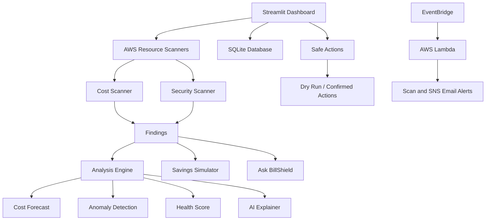

# 🛡️ BillShield -AWS — Cloud Cost & Security Guardian for Students

\<p align="center">
&#x20; \<strong>Catch the waste. Close the risk. Before the bill arrives.\</strong>
\</p>

\<p align="center">
&#x20; \<a href="[https://billshield-kiran.streamlit.app/](https://billshield-kiran.streamlit.app/)">
&#x20;   \
&#x20; \</a>
&#x20; \
&#x20; \
&#x20; \
&#x20; \
\</p>

---

## 🚀 Live Demo

**Try BillShield without creating an AWS account!**

🌐 **Live Application:** [https://billshield-kiran.streamlit.app/](https://billshield-kiran.streamlit.app/)

- Demo Mode uses synthetic AWS data.
- No AWS account is required to explore the demo.
- Explore cloud cost monitoring, security findings, forecasting and savings simulation.

> Note: The live demo runs in Demo Mode. Connect your own AWS account only when using a locally configured instance.

---

## 📌 About BillShield

**BillShield v2** is a cloud cost optimization and security monitoring application designed to help students and developers understand, monitor and manage their AWS cloud resources.

Cloud services can generate unexpected bills when resources are left unused or security configurations are mismanaged.

BillShield helps identify potential cloud waste, detect common security misconfigurations, estimate cloud expenses and understand possible savings through an interactive dashboard.

It combines AWS resource scanning, cost forecasting, security analysis and explainable findings in one easy-to-use application.

### 🎯 What BillShield Does

- Detects potentially wasted AWS resources.
- Identifies common AWS security misconfigurations.
- Estimates cloud costs and predicts month-end spending.
- Calculates an explainable cloud health score.
- Provides AI-assisted explanations in multiple languages.
- Simulates potential savings before taking action.
- Supports safe, confirmation-based remediation.

---

## ✨ Key Features

| Feature               | Description                                                                                                        |
| --------------------- | ------------------------------------------------------------------------------------------------------------------ |
| ☁️ Cost Scanner       | Detects stopped EC2 instances, unattached EBS volumes, unused Elastic IPs, old snapshots and running NAT Gateways. |
| 🔐 Security Scanner   | Identifies public S3 buckets, risky security group rules and IAM users without MFA.                                |
| 💰 Cost Estimator     | Estimates potential AWS resource costs using configurable pricing data.                                            |
| 📊 Cost Forecast      | Predicts month-end spending using recent usage trends.                                                             |
| 🚨 Anomaly Detection  | Identifies unusual daily spending patterns.                                                                        |
| ❤️ Cloud Health Score | Calculates an explainable score based on waste and security findings.                                              |
| 🤖 AI Explainer       | Explains technical findings in simple language.                                                                    |
| 💡 Savings Simulator  | Estimates savings and score improvements before applying fixes.                                                    |
| 📋 Fix-Order Planner  | Provides a prioritized checklist for resolving findings.                                                           |
| 💬 Ask BillShield     | Answers questions using available scan findings.                                                                   |
| 📈 Bill Shock Meter   | Compares forecasted expenses against your configured budget.                                                       |
| ⚙️ Settings           | Supports language, theme, currency, budget and optional integrations.                                              |
| 🛠️ Safe Actions      | Supports dry-run operations and explicitly confirmed Elastic IP release actions.                                   |
| 📄 Reports            | Generates CSV and PDF reports.                                                                                     |

---

## 🔍 AWS Resources Monitored

### Cost Optimization Scanner

- Stopped EC2 instances.
- Unattached EBS volumes.
- Unused Elastic IP addresses.
- EBS snapshots older than 90 days.
- Running NAT Gateways.

### Security Scanner

- Publicly accessible S3 buckets.
- Security groups allowing unrestricted access (`0.0.0.0/0`) on:
  - Port 22 — SSH
  - Port 3389 — RDP
- IAM users without Multi-Factor Authentication (MFA).

---

## 📊 Cost Forecasting & Intelligence

BillShield includes multiple analysis features to help users understand cloud spending.

**1. Month-End Cost Forecast**

Uses current spending and the average spending over the previous seven days to estimate the remaining month's cost.

**2. Anomaly Detection**

Identifies unusual daily spending when it exceeds the previous seven-day mean by a configured statistical threshold.

**3. Cloud Health Score**

Provides an explainable score based on detected waste and security findings.

**4. Savings Simulator**

Allows users to select findings and preview estimated savings and score improvements before applying any changes.

---

## 🌍 Multi-Language Support

BillShield supports four interface languages:

- 🇬🇧 English
- 🇮🇳 தமிழ் (Tamil)
- 🇮🇳 हिन्दी (Hindi)
- 🇮🇳 മലയാളം (Malayalam)

The AI explainer uses rule-based explanations, with optional Amazon Bedrock integration.

---

## 🏗️ System Architecture



---

## 🛠️ Technology Stack

| Category                | Technologies                 |
| ----------------------- | ---------------------------- |
| Programming Language    | Python                       |
| Frontend / Dashboard    | Streamlit                    |
| AWS SDK                 | Boto3                        |
| Cloud Platform          | Amazon Web Services          |
| Database                | SQLite                       |
| AI Integration          | Amazon Bedrock (Optional)    |
| Testing                 | Pytest, Moto                 |
| Reporting               | CSV, ReportLab PDF           |
| Automation Architecture | EventBridge, AWS Lambda, SNS |
| Version Control         | Git and GitHub               |

---

## 📂 Project Structure

```text
BUILD-BILLSHIELD-AWS/
│
├── dashboard/
│   ├── app.py
│   └── assets/
│       └── logo.svg
│
├── infra/
│   ├── iam_policy_readonly.json
│   ├── lambda_handler.py
│   └── DEPLOY.md
│
├── tests/
│
├── requirements-dev.txt
├── config.py
├── README.md
└── .streamlit/
```

> Additional modules and folders are maintained in the repository.

---

## ⚙️ Installation & Setup

### Prerequisites

- Python 3.11 or higher.
- Git.
- AWS CLI (only required when connecting a real AWS account).
- An AWS account (optional for Demo Mode).

### 1. Clone the Repository

```bash
git clone https://github.com/Kirankumar43-byte/BUILD-BILLSHIELD-AWS.git

cd BUILD-BILLSHIELD-AWS
```

### 2. Create a Virtual Environment

**Windows PowerShell:**

```powershell
python -m venv venv

venv\Scripts\activate
```

### 3. Install Dependencies

```powershell
python -m pip install --upgrade pip

python -m pip install -r requirements-dev.txt
```

### 4. Run Tests

```powershell
python -m pytest -q
```

Expected result for the current test suite:

```text
24 passed
```

### 5. Start BillShield

```powershell
python -m streamlit run dashboard/app.py
```

Open the displayed local URL in your browser and click **Try Demo Mode**.

> Windows tip: Use `python -m streamlit` instead of the bare `streamlit` command to avoid broken-launcher errors.

---

## 🔌 Connecting Your AWS Account

BillShield supports connecting an AWS account for read-only resource scanning.

### Recommended: AWS CLI Profile

Configure an AWS profile:

```powershell
aws configure --profile billshield
```

Use credentials belonging to an IAM user or role configured with the project's read-only policy:

`infra/iam_policy_readonly.json`

Then select the AWS profile in BillShield and test the connection.

### Security Precautions

- Never use AWS root account credentials.
- Never commit AWS access keys or secret keys to GitHub.
- Use the least-privilege IAM permissions.
- Review the IAM policy before connecting.
- Keep credentials private.

---

## 🔐 Security & Safe Actions

Security is an important part of BillShield.

- AWS scanning is read-only.
- Root account access is rejected.
- Credentials pasted into the application are kept in memory for the browser session and are not saved or logged, according to the application design.
- Dry-run mode is enabled by default.
- Real Elastic IP release actions require Live Mode, the Settings switch and typed confirmation (`CONFIRM <id>`).
- Actions are recorded in the audit log.
- Inputs are validated before supported actions are processed.

For deployment information, review:

`infra/DEPLOY.md`

---

## 🧪 Testing

BillShield includes automated tests using:

- Pytest
- Moto AWS mocks

Run the test suite:

```bash
python -m pytest -q
```

The current documented test result is **24 passed**.

> Tests use mocked AWS services. The application has not been validated against a real AWS account.

---

## ⚠️ Limitations & Important Notes

- AWS cost figures are approximate estimates and should be verified against official AWS pricing.
- Cost Explorer requests may incur charges.
- Amazon Bedrock usage may incur charges.
- AWS infrastructure such as EC2 and App Runner may incur charges when deployed.
- Idle EC2 detection based on CPU utilization is not currently included.
- PDF reports are currently English-only.
- Translations are AI-assisted and should be reviewed by native speakers.
- The dark theme is the primary polished theme; the light theme is basic.
- The live demo uses synthetic data.
- Real AWS deployment and scanning have not been validated; testing is performed using mocked AWS services.

Official AWS pricing: [https://aws.amazon.com/pricing/](https://aws.amazon.com/pricing/)

---

## 🗺️ Future Improvements

Potential future enhancements:

- Advanced cloud cost anomaly detection.
- More AWS resource coverage.
- Enhanced cloud security recommendations.
- Improved multilingual PDF reporting.
- Additional cloud provider integrations.
- More automated remediation options with explicit user approval.

These are future development ideas, not claims of currently implemented functionality.

---

## 🤝 Contributing

Contributions, suggestions and feedback are welcome!

1. Fork this repository.
2. Create a new feature branch.
3. Make your changes.
4. Run the test suite.
5. Submit a pull request.

---

## 📜 License

This project is licensed under the **MIT License**.

See the `LICENSE` file for more information.

---

## 👨‍💻 Author

**Kiran Kumar M**

B.Tech — Artificial Intelligence and Data Science

Interested in Cloud Computing, AWS, Cybersecurity, Artificial Intelligence and Software Development.

\<p align="left">
&#x20; \<a href="[https://github.com/Kirankumar43-byte](https://github.com/Kirankumar43-byte)">
&#x20;   \
&#x20; \</a>
&#x20; \<a href="[https://billshield-kiran.streamlit.app/](https://billshield-kiran.streamlit.app/)">
&#x20;   \
&#x20; \</a>
\</p>

---

\<p align="center">
&#x20; ⭐ If you find BillShield useful, consider starring this repository!
\</p>

\<p align="center">
&#x20; \<strong>BillShield v2 — Catch the waste. Close the risk.\</strong>
\</p>
