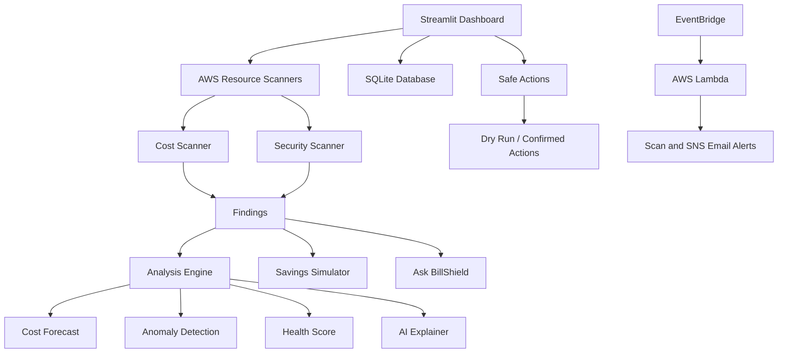

# 🛡️ BillShield-AWS — Cloud Cost & Security Guardian for Students

**Catch the waste. Close the risk. Before the bill arrives.**

[](https://billshield-kiran.streamlit.app/)


---

## 🚀 Live Demo

**Explore BillShield without creating an AWS account!**

🔗 **Live Application:** https://billshield-kiran.streamlit.app/

- Try the application using Demo Mode.
- Explore synthetic AWS resource findings.
- View cost forecasts and security analysis.
- Test the Savings Simulator.
- Explore the interactive dashboard.

> **Note:** The hosted application uses synthetic data in Demo Mode. Real AWS scanning requires a locally configured instance.

---

## 📌 About the Project

**BillShield-AWS** is an AWS cloud cost optimization and security monitoring application designed to help students and developers understand and manage their cloud resources.

Cloud services can generate unexpected bills when resources are unused or security configurations are mismanaged.

BillShield helps users identify potential cloud waste, detect common security misconfigurations, estimate monthly expenses and understand possible savings through an interactive Streamlit dashboard.

It combines AWS resource scanning, cost forecasting, security analysis and explainable findings in one application.

### 🎯 Main Objectives

- Identify potentially wasted AWS resources.
- Detect common cloud security risks.
- Estimate cloud expenses.
- Forecast month-end spending.
- Improve cloud resource awareness.
- Help users understand security findings.
- Simulate savings before applying fixes.

---

## ✨ Key Features

| Feature | Description |
|---|---|
| ☁️ Cost Scanner | Detects stopped EC2, unattached EBS, unused Elastic IPs, old snapshots and running NAT Gateways. |
| 🔐 Security Scanner | Identifies public S3 buckets, risky security group rules and IAM users without MFA. |
| 💰 Cost Estimator | Estimates AWS resource costs using configurable pricing data. |
| 📊 Cost Forecast | Predicts month-end spending using recent spending trends. |
| 🚨 Anomaly Detection | Identifies unusual daily spending patterns. |
| ❤️ Cloud Health Score | Provides an explainable score based on waste and security findings. |
| 🤖 AI Explainer | Explains technical findings in simple language. |
| 💡 Savings Simulator | Previews potential savings before applying fixes. |
| 📋 Fix-Order Planner | Provides a prioritized checklist for resolving findings. |
| 💬 Ask BillShield | Answers questions using available scan findings. |
| 📈 Bill Shock Meter | Compares forecasted expenses against your budget. |
| ⚙️ Settings | Supports language, theme, currency, budget and optional integrations. |
| 🛠️ Safe Actions | Provides dry-run operations and confirmed Elastic IP release actions. |
| 📄 Reports | Generates CSV and PDF reports. |

---

## 🔍 AWS Resources Monitored

### 1. Cost Optimization Scanner

BillShield identifies potentially unnecessary AWS resources:

- Stopped EC2 instances.
- Unattached EBS volumes.
- Unused Elastic IP addresses.
- EBS snapshots older than 90 days.
- Running NAT Gateways.

### 2. Security Scanner

BillShield checks for common AWS security issues:

- Publicly accessible S3 buckets.
- Security groups allowing unrestricted access (`0.0.0.0/0`) on port 22 (SSH).
- Security groups allowing unrestricted access (`0.0.0.0/0`) on port 3389 (RDP).
- IAM users without Multi-Factor Authentication (MFA).

---

## 📊 Cloud Cost Intelligence

### Month-End Forecast

Estimates month-end spending using:

- Current spending.
- Average spending over the previous seven days.
- Remaining days in the month.
- An estimated uncertainty range.

### Anomaly Detection

Identifies unusual daily spending using a statistical threshold based on the previous seven days.

### Cloud Health Score

Calculates an explainable score based on detected cloud waste and security findings.

### Savings Simulator

Allows users to select findings and preview estimated savings and health score improvements before taking action.

---

## 🌍 Multi-Language Support

BillShield supports four interface languages:

| Language | Support |
|---|---|
| English | 🇬🇧 |
| Tamil | தமிழ் |
| Hindi | हिन्दी |
| Malayalam | മലയാളം |

The AI explainer provides rule-based explanations, with optional Amazon Bedrock integration.

---

## 🏗️ System Architecture



---

## 🛠️ Technology Stack

| Category | Technologies |
|---|---|
| Programming Language | Python |
| Dashboard | Streamlit |
| AWS SDK | Boto3 |
| Cloud Platform | Amazon Web Services |
| Database | SQLite |
| AI Integration | Amazon Bedrock (Optional) |
| Testing | Pytest, Moto |
| Reporting | CSV, ReportLab PDF |
| Automation | EventBridge, AWS Lambda, SNS |
| Version Control | Git, GitHub |

---

## 📂 Project Structure

```text
BUILD-BILLSHIELD-AWS/
│
├── .streamlit/
│
├── dashboard/
│   ├── app.py
│   └── assets/
│       └── logo.svg
│
├── infra/
│   ├── iam_policy_readonly.json
│   ├── lambda_handler.py
│   └── DEPLOY.md
│
├── tests/
│
├── config.py
├── requirements-dev.txt
└── README.md
```

---

## ⚙️ Installation and Setup

### Prerequisites

- Python 3.11 or higher.
- Git.
- AWS CLI (required only for connecting a real AWS account).
- AWS account (optional for Demo Mode).

### Step 1: Clone the Repository

```bash
git clone https://github.com/Kirankumar43-byte/BUILD-BILLSHIELD-AWS.git

cd BUILD-BILLSHIELD-AWS
```

### Step 2: Create a Virtual Environment

**Windows PowerShell:**

```powershell
python -m venv venv

venv\Scripts\activate
```

### Step 3: Install Dependencies

```powershell
python -m pip install --upgrade pip

python -m pip install -r requirements-dev.txt
```

### Step 4: Run Tests

```powershell
python -m pytest -q
```

Expected result from the documented test suite:

```text
24 passed
```

### Step 5: Run the Application

```powershell
python -m streamlit run dashboard/app.py
```

Open the local URL displayed in your terminal.

Click **Try Demo Mode** to explore BillShield without an AWS account.

> **Windows Tip:** Use `python -m streamlit` instead of the bare `streamlit` command to avoid broken-launcher errors.

---

## 🔌 Connecting an AWS Account

BillShield supports connecting an AWS account for read-only resource scanning.

### Recommended: AWS CLI Profile

Configure an AWS profile:

```powershell
aws configure --profile billshield
```

Use an IAM user or role configured with the project's read-only policy:

`infra/iam_policy_readonly.json`

Then:

1. Open BillShield.
2. Select your AWS profile.
3. Choose the required AWS regions.
4. Click **Test Connection**.
5. Start the read-only scan.

The application displays a masked account ID and identity and rejects root account access.

**Important:** Never use AWS root credentials or commit AWS access keys to GitHub.

---

## 🔐 Security and Safe Actions

Security is an important part of BillShield.

- AWS resource scanning is read-only.
- Root account access is rejected.
- Pasted credentials are kept in memory for the browser session and are not saved or logged, according to the application design.
- Dry-run mode is enabled by default.
- Real Elastic IP release requires Live Mode, the Settings switch and typed confirmation.
- Supported actions are recorded in the audit log.
- Input validation is performed before supported actions.

For deployment instructions, refer to:

`infra/DEPLOY.md`

---

## 🧪 Testing

BillShield uses:

- **Pytest** for automated testing.
- **Moto** for AWS service mocking.

Run the test suite:

```bash
python -m pytest -q
```

The documented test result is:

**24 passed**

> Testing has been performed using mocked AWS services. The application has not been validated against a real AWS account.

---

## ⚠️ Limitations and Important Notes

- AWS cost figures are approximate estimates. Verify actual prices using official AWS pricing.
- Cost Explorer requests may incur charges.
- Amazon Bedrock usage may incur charges.
- Deploying AWS infrastructure such as EC2 or App Runner may incur charges.
- CPU-based idle EC2 detection is not currently included.
- PDF reports are currently English-only.
- Translations are AI-assisted and should be reviewed by native speakers.
- The dark theme is the primary polished theme; the light theme is basic.
- The hosted demo uses synthetic data.
- Real AWS deployment and scanning have not been validated.

Official AWS Pricing: https://aws.amazon.com/pricing/

---

## 🗺️ Future Improvements

Potential future enhancements:

- Advanced cloud cost anomaly detection.
- Additional AWS resource coverage.
- Improved cloud security recommendations.
- Multilingual PDF reporting.
- Additional cloud provider integrations.
- More automated remediation options with explicit user approval.

These are planned improvements, not currently implemented features.

---

## 🤝 Contributing

Contributions, suggestions and feedback are welcome!

1. Fork this repository.
2. Create a new branch.
3. Make your changes.
4. Run the tests.
5. Submit a Pull Request.

---

## 📜 License

This project is licensed under the **MIT License**.

See the `LICENSE` file in the repository for details.

---

## 👨‍💻 Author

### Kiran Kumar M

**B.Tech — Artificial Intelligence and Data Science**

Interested in:

- Cloud Computing and AWS
- Cybersecurity
- Artificial Intelligence and Machine Learning
- Software Development

**GitHub:** https://github.com/Kirankumar43-byte

**Project Repository:** https://github.com/Kirankumar43-byte/BUILD-BILLSHIELD-AWS

**Live Application:** https://billshield-kiran.streamlit.app/

---

⭐ If you find BillShield useful, consider giving this repository a star!

**BillShield v2 — Catch the waste. Close the risk. Before the bill arrives.**
